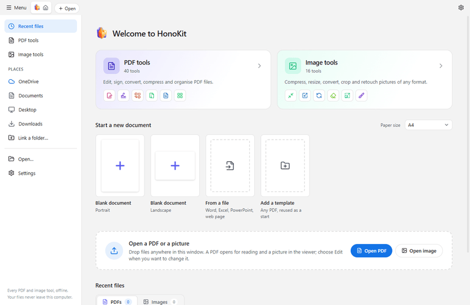
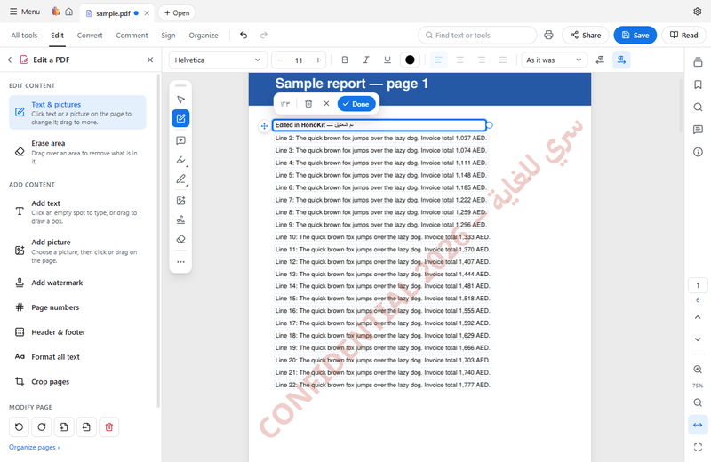
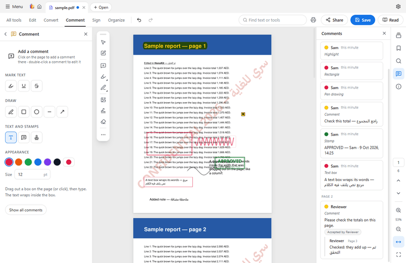
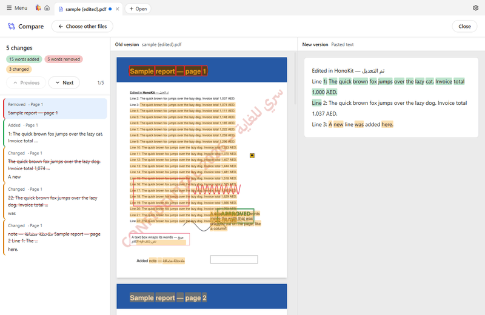
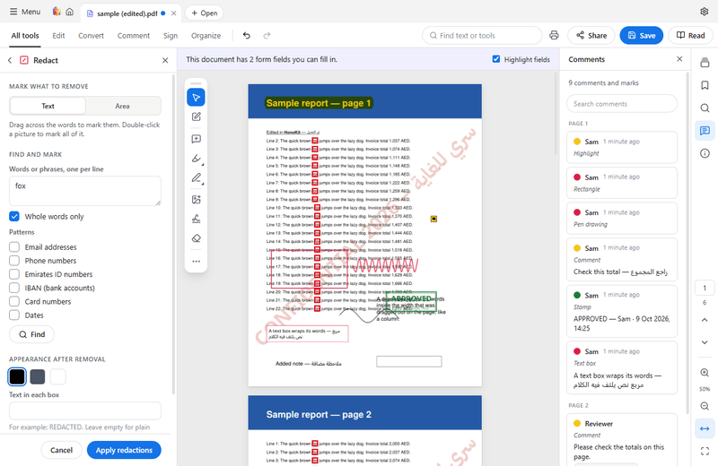
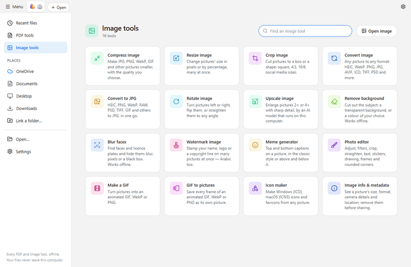

<p align="center">
  
</p>

<h1 align="center">HonoKit</h1>

<p align="center">
  <b>Every PDF and image tool, offline on your PC. Arabic and right-to-left first.</b>
</p>

<p align="center">
  <a href="https://github.com/abd-el-rahman-mustafa/HonoKit/releases/latest"><b>Download for Windows</b></a> ·
  <a href="https://github.com/abd-el-rahman-mustafa/HonoKit-Android">HonoKit for Android</a> ·
  <a href="https://github.com/abd-el-rahman-mustafa/HonoKit/issues/new?template=bug_report.yml">Report a problem</a> ·
  <a href="LICENSE">AGPL-3.0</a>
</p>

HonoKit is a free, open-source PDF editor and image toolkit for Windows. Your files are opened,
changed and saved on your own computer: **no account, no cloud, no telemetry**. Text recognition,
spell check and the image AI all run offline. Arabic is first-class throughout — a right-to-left
interface, correctly shaped Arabic in everything the app writes, and search that understands Arabic.

<table>
  <tr>
    <td></td>
    <td></td>
  </tr>
  <tr>
    <td></td>
    <td></td>
  </tr>
  <tr>
    <td></td>
    <td></td>
  </tr>
</table>

## Features

**English and Arabic.** The whole interface in English or Arabic (right to left), with light and
dark themes. Arabic text is shaped correctly in everything the app writes, edits and recognizes.

**Read.** A fast viewer first: tabs, thumbnails, bookmarks, zoom, find that ignores Arabic
diacritics and letter variants, links that open only after asking. A picture viewer for every
format the image tools read.

**Edit.** Click a paragraph and change it in place, in the page's own font, Arabic or English;
find & replace; add text, text boxes and pictures; move, resize, replace and delete pictures;
erase an area; watermarks, page numbers, headers and footers; spell check in Arabic and English.

**Comment.** Highlight, underline, strike through, pen, shapes, sticky notes, stamps, replies and
review states — standard PDF annotations any reader shows.

**Sign.** Draw, type or use a picture of your signature; sign with a digital ID (.pfx/.p12, or
one made in the app) and check the signatures in a file.

**Forms.** Fill in forms, and prepare your own (text fields, check boxes, lists, signature fields).

**Protect & redact.** Passwords (AES-256) and permissions; true redaction that removes the words,
pictures and hidden information under the marks (find words, emails, phone numbers, IBANs and
more); the author's restrictions are respected.

**Organize.** Merge, split, reorder, rotate, insert, extract, replace, duplicate and delete pages;
crop and trim margins; compress; compare two PDFs word by word.

**Convert.** PDF to Word, Excel, PowerPoint, Markdown and pictures; Word, Excel, PowerPoint, web
pages and pictures to PDF — without Office.

**OCR & scan.** Recognize text in scanned pages (Arabic and English) to make them searchable;
scan from a scanner, scan ID cards and books; picture to text, Word or Excel.

**Image tools.** Sixteen tools on one board each: convert (HEIC, camera RAW, PSD, JPEG XL, AVIF,
WebP and more), compress, resize, crop, rotate, watermark, meme, photo editor, GIF maker, GIF to
pictures, icon maker, info & metadata — and offline AI to **upscale**, **remove the background** and
**blur faces and licence plates**.

**Batch.** Chain steps into a workflow and run it over many files.

## Download

Get the latest version from the
**[Releases page](https://github.com/abd-el-rahman-mustafa/HonoKit/releases/latest)**.

| Computer | File |
| --- | --- |
| **Windows 10/11** | `HonoKit-Setup-<version>.exe` — installs for your user only, no administrator needed, and updates itself |
| Windows, no installation | `HonoKit-<version>-portable.exe` |

The builds are not yet signed with a certificate, so Windows asks once: on "Windows protected
your PC" click **More info → Run anyway**.

The installed app checks the Releases page for a new version; nothing downloads until you click
**Download**, and you can turn the check off in **Settings › Updates**.

**On a phone?** [HonoKit for Android](https://github.com/abd-el-rahman-mustafa/HonoKit-Android).

## Building from source

Needs [Node.js](https://nodejs.org) 20 or later (see `engines` in package.json) and Windows 10/11.

```bash
npm ci
npm run dev        # run the app with hot reload
npm run typecheck  # TypeScript, both processes
npm test           # the test suite; every test document is generated by the tests
npm run smoke      # build, drive the real app in English and Arabic, screenshots in smoke-out/
npm run dist:win   # installers in release/
```

`Run HonoKit.cmd` starts the last build (`npm run build`) with the Electron in `node_modules`.

## Contributing

Bug reports, ideas, translations and pull requests are welcome — see
[CONTRIBUTING.md](CONTRIBUTING.md). In short: **fork** the repository, create a **branch**, make
your change with tests, run `npm run typecheck` and `npm test`, and open a **pull request**.

- Something wrong? Use **Settings › About › Report a problem** in the app, or open an
  [issue](https://github.com/abd-el-rahman-mustafa/HonoKit/issues/new/choose). Attach a file only
  if it has nothing private in it.
- A security problem? Please report it privately: [SECURITY.md](SECURITY.md).

## Privacy

HonoKit sends nothing about you or your files. Its only connection is the update check to GitHub
Releases, which you can turn off. Details: [PRIVACY.md](PRIVACY.md).

## Code signing policy

Free code signing provided by [SignPath.io](https://signpath.io), certificate by
[SignPath Foundation](https://signpath.org) (once approved; until then releases are unsigned).

- Committers and reviewers: [@abd-el-rahman-mustafa](https://github.com/abd-el-rahman-mustafa)
- Approvers: [@abd-el-rahman-mustafa](https://github.com/abd-el-rahman-mustafa)

What is signed: `HonoKit.exe`, the installer (`HonoKit-Setup-x.y.z.exe`), its uninstaller and the
portable exe. Electron's own DLLs are included unsigned, as the policy requires for third-party
files.

## Licence

Free software under the [GNU Affero General Public License 3.0 or later](LICENSE), because it is
built on [MuPDF](https://mupdf.com). Third-party components, models, dictionaries and fonts:
[THIRD_PARTY_NOTICES.md](THIRD_PARTY_NOTICES.md).
